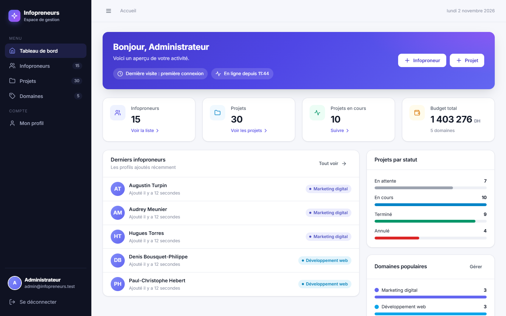
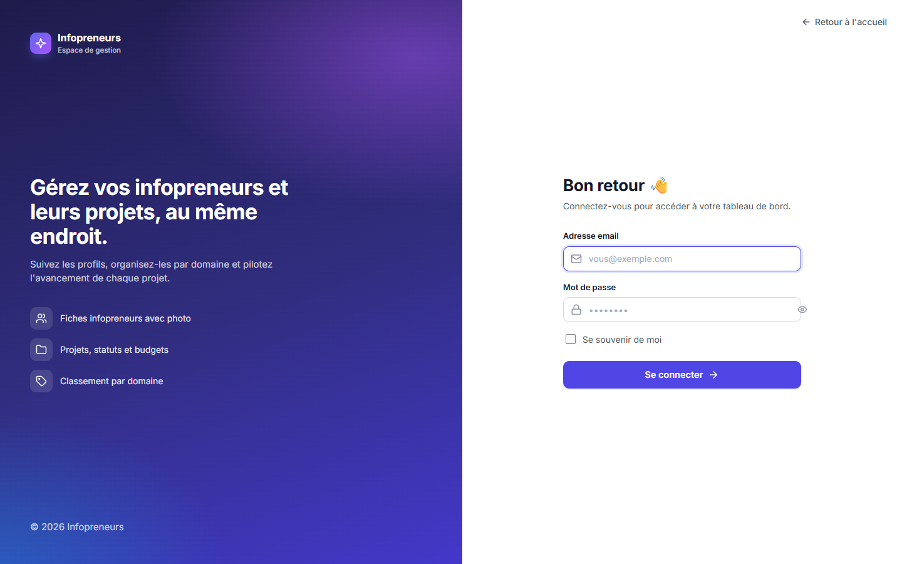
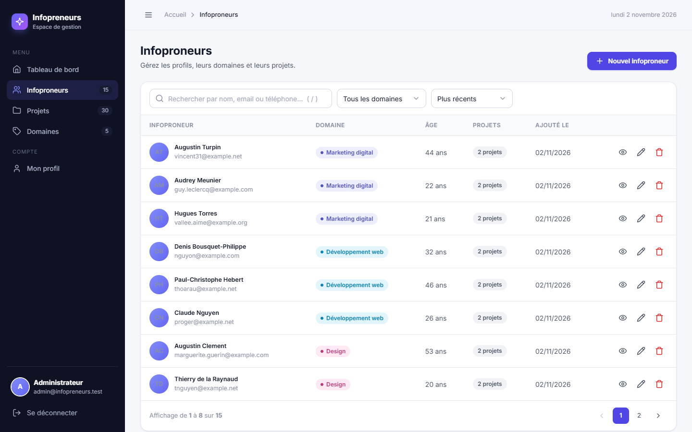
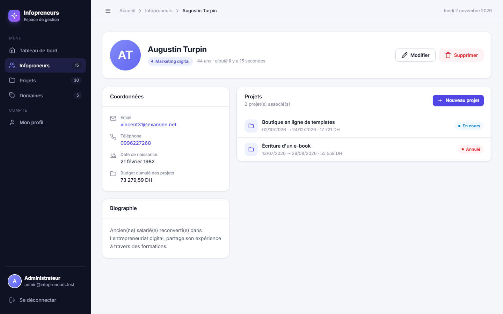
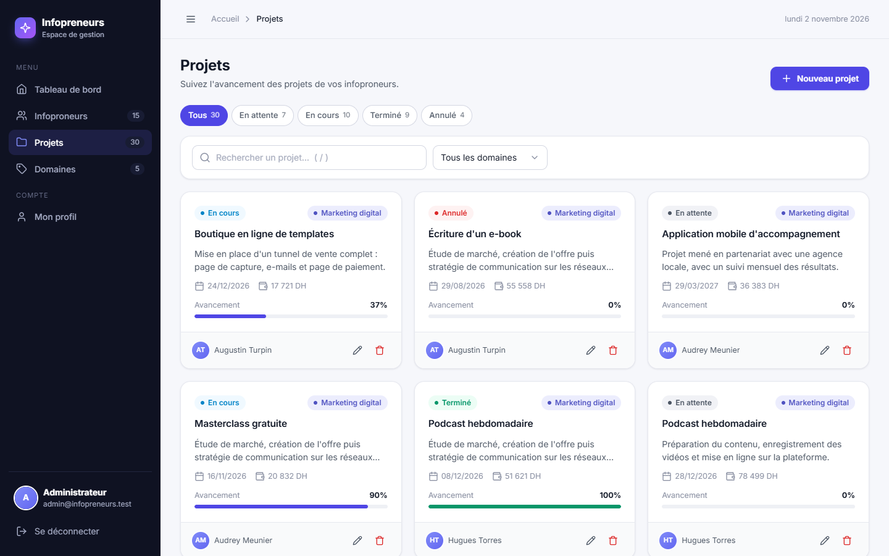
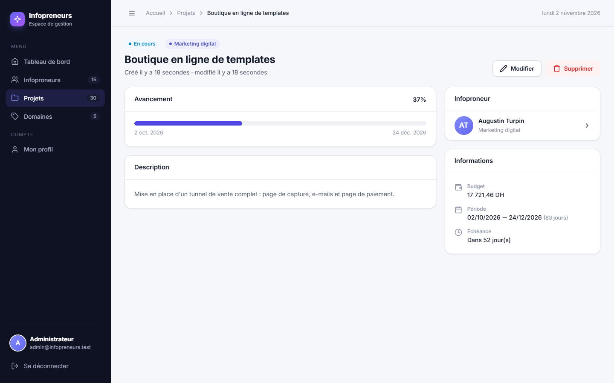
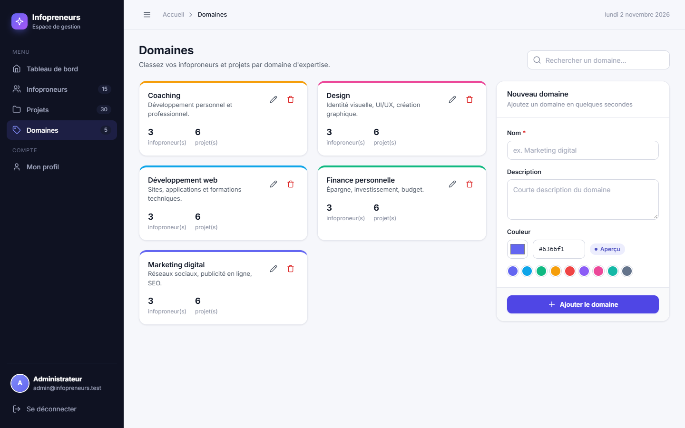
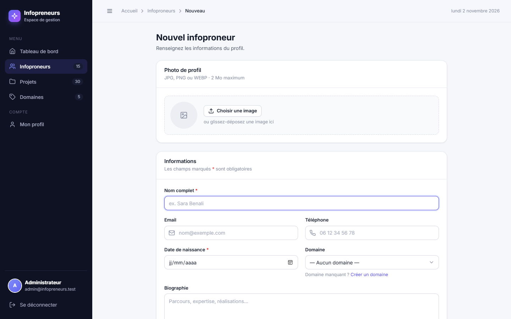
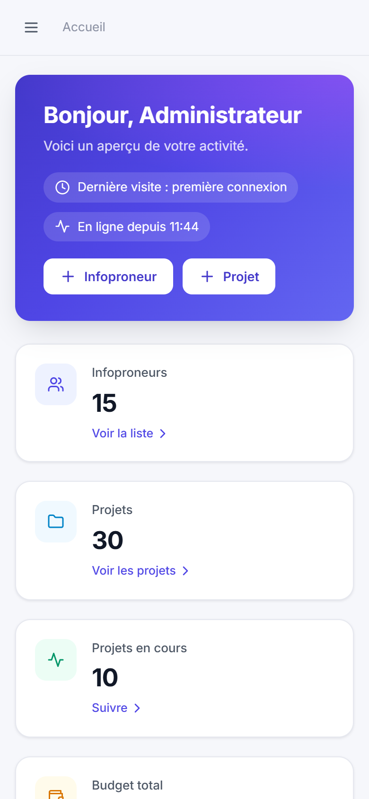
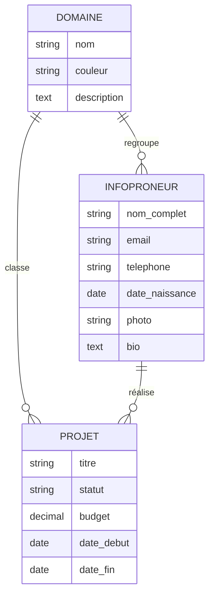

<div align="center">

# ✨ Gestion Infopreneurs

**Une application web moderne pour gérer des infopreneurs, leurs projets et leurs domaines d'expertise.**

[](https://laravel.com)
[](https://www.php.net)
[](https://www.mysql.com)
[](#-tests)

[Aperçu](#-aperçu) · [Fonctionnalités](#-fonctionnalités) · [Installation](#-installation) · [Architecture](#-architecture) · [Tests](#-tests)

<br>


</div>

---

## 📸 Aperçu

<table>
  <tr>
    <td width="50%"><p align="center"><b>Tableau de bord</b><br><sub>Chiffres clés, statuts des projets, budget total, activité récente</sub></p></td>
    <td width="50%"><p align="center"><b>Connexion</b><br><sub>Authentification sécurisée avec limitation des tentatives</sub></p></td>
  </tr>
  <tr>
    <td><p align="center"><b>Infoproneurs</b><br><sub>Recherche, filtre par domaine, tri, pagination</sub></p></td>
    <td><p align="center"><b>Fiche infoproneur</b><br><sub>Profil complet avec photo et liste de ses projets</sub></p></td>
  </tr>
  <tr>
    <td><p align="center"><b>Projets</b><br><sub>Filtres par statut et domaine, avancement automatique</sub></p></td>
    <td><p align="center"><b>Détail d'un projet</b><br><sub>Budget, période, échéance et progression</sub></p></td>
  </tr>
  <tr>
    <td><p align="center"><b>Domaines</b><br><sub>Catégories avec couleur personnalisée</sub></p></td>
    <td><p align="center"><b>Formulaire</b><br><sub>Upload de photo par glisser-déposer avec aperçu</sub></p></td>
  </tr>
</table>

<details>
<summary><b>📱 Version mobile</b> (cliquer pour afficher)</summary>
<br>
<p align="center">
  
  &nbsp;&nbsp;
  
</p>
</details>

---

## 🚀 Fonctionnalités

| | Module | Ce qu'il permet |
|---|---|---|
| 🏠 | **Page d'accueil** | Présentation publique de l'application avec statistiques en direct |
| 🔐 | **Authentification** | Connexion, « se souvenir de moi », limitation à 10 tentatives/minute, suivi de la dernière visite |
| 📊 | **Tableau de bord** | Totaux, projets en cours, budget global en DH, répartition par statut, domaines populaires |
| 👤 | **Infopreneurs** | CRUD complet, photo de profil, recherche (nom, email, téléphone), filtre par domaine, tri |
| 📁 | **Projets** | Statuts (en attente, en cours, terminé, annulé), budget, dates, **avancement calculé automatiquement** |
| 🏷️ | **Domaines** | Catégories colorées, compteurs d'infopreneurs et de projets |
| ⚙️ | **Profil** | Modifier nom, email, avatar et mot de passe |

**Et aussi :** notifications toast, fenêtre de confirmation avant suppression, raccourci <kbd>/</kbd> pour la recherche, interface 100 % responsive, messages de validation en français.

---

## 🛠️ Technologies

- **Back-end :** PHP 8.1+, Laravel 10 (Eloquent, Form Requests, Blade components)
- **Base de données :** MySQL (SQLite en mémoire pour les tests)
- **Front-end :** HTML, CSS et JavaScript natifs, **sans build** ni framework
- **Qualité :** PHPUnit (tests de fonctionnalités), Laravel Pint (style de code)

---

## 📦 Installation

### Prérequis

- PHP ≥ 8.1 avec les extensions `pdo_mysql`, `mbstring`, `fileinfo`
- [Composer](https://getcomposer.org)
- MySQL (ou MariaDB), par exemple via XAMPP / Laragon

### Étapes

```bash
# 1. Cloner le projet
git clone https://github.com/bouincha/Gestion-infopreneurs.git
cd Gestion-infopreneurs

# 2. Installer les dépendances
composer install

# 3. Configurer l'environnement
cp .env.example .env
php artisan key:generate
```

Créez une base de données vide (ex. `infopreneurs`), puis renseignez-la dans `.env` :

```env
DB_DATABASE=infopreneurs
DB_USERNAME=root
DB_PASSWORD=
```

```bash
# 4. Créer les tables + données de démonstration
php artisan migrate --seed

# 5. Lancer le serveur
php artisan serve
```

Ouvrez **<http://127.0.0.1:8000>** 🎉

### 🔑 Compte de démonstration

| Email | Mot de passe |
|---|---|
| `admin@infopreneurs.test` | `password` |

> Il n'y a pas de page d'inscription : les comptes sont créés par le seeder ou via `php artisan tinker`.

---

## 🧱 Architecture

### Modèle de données



- Supprimer un infopreneur supprime ses projets et sa photo.
- Supprimer un domaine ne supprime rien : les infopreneurs et projets liés deviennent « sans domaine ».

### Structure du projet

```
app/
├── Http/Controllers/      # Landing, Auth, Dashboard, Infoproneur, Projet, Domaine, Profile, Media
├── Http/Requests/         # Règles de validation partagées (création / modification)
└── Models/                # Domaine, Infoproneur, Projet, User
resources/views/
├── landing.blade.php      # Page d'accueil publique
├── layouts/app.blade.php  # Mise en page : menu latéral, notifications, modale
├── components/            # x-icon, x-avatar, x-status-badge, x-domaine-badge…
└── infoproneurs/ projets/ domaines/ profile/
public/
├── css/app.css            # Toute l'interface
└── js/app.js              # Interactions (aperçu photo, modale, filtres…)
tests/Feature/             # Tests de bout en bout
```

---

## ✅ Tests

```bash
php artisan test
```

Les tests tournent sur une base SQLite en mémoire : ils ne touchent jamais votre base MySQL.
Ils couvrent l'authentification, la page d'accueil, le CRUD des trois modules, la recherche, les filtres, l'upload de photos et la validation.

---

<div align="center">

Réalisé avec ❤️ par **[bouincha](https://github.com/bouincha)** · Projet de 2ᵉ année

</div>
